## . Diagrama Visual Completo (Mermaid Architectural Map)

Este código pode ser renderizado diretamente em editores de Markdown, publicado no GitHub, ou importado no **Diagrams.net (Draw\.io)** e **Miro** (via plugin Mermaid).

Snippet de código

```mermaid ,
flowchart TD
    %% ESTILOS VISUAIS (CLASSES DE CORES)
    classDef core fill:#FF6B00,stroke:#121212,stroke-width:3px,color:#fff,font-weight:bold;
    classDef historico fill:#546E7A,stroke:#333,stroke-width:1px,color:#fff;
    classDef api fill:#00695C,stroke:#333,stroke-width:1px,color:#fff;
    classDef turing fill:#121212,stroke:#FF5500,stroke-width:2px,color:#FF5500,font-weight:bold;
    classDef agro fill:#2E7D32,stroke:#333,stroke-width:1px,color:#fff;
    classDef raiz fill:#1565C0,stroke:#333,stroke-width:1px,color:#fff;
    classDef coins fill:#F57F17,stroke:#333,stroke-width:1px,color:#fff;
    classDef console fill:#37474F,stroke:#333,stroke-width:1px,color:#fff;
    classDef wp fill:#D81B60,stroke:#333,stroke-width:1px,color:#fff;
    classDef mobile fill:#6A1B9A,stroke:#333,stroke-width:1px,color:#fff;
    classDef sec fill:#C62828,stroke:#333,stroke-width:1px,color:#fff;
    classDef mercado fill:#E65100,stroke:#333,stroke-width:1px,color:#fff;
    classDef futuro fill:#00838F,stroke:#333,stroke-width:1px,color:#fff;

    %% NÓ CENTRAL
    NTC["NEXOTERRACORE\n(Ecossistema & Plataforma Central)"]:::core

    %% RAMO 1: EVOLUÇÃO HISTÓRICA
    subgraph R1["1. Evolução Histórica (Incorporação Contínua)"]
        H1["Agro Digital"] --> H2["AgroCore"] --> H3["AgroNext / AgroCore"] --> H4["NexoTerraCore API"]
    end
    NTC --- R1
    class H1,H2,H3,H4 historico;

    %% RAMO 2: NÚCLEO TECNOLÓGICO
    subgraph R2["2. Núcleo Tecnológico"]
        API["NexoTerraCore API Central"]
        API_1["Multitenancy (organizacao_id)"]
        API_2["PostgreSQL + RLS"]
        API_3["Auth (OAuth2/JWT) & API Keys"]
        API_4["Rate Limit & WAF"]
        API_5["Interoperabilidade & Webhooks"]
        API --- API_1 & API_2 & API_3 & API_4 & API_5
    end
    NTC --- R2
    class API,API_1,API_2,API_3,API_4,API_5 api;

    %% RAMO 3: TURING (IA)
    subgraph R3["3. Agente de IA Turing"]
        TUR["Turing AI Agent"]
        TUR_1["Chat Público & Conhecimento Geral"]
        TUR_2["RAG & Conhecimento Interno Seguro"]
        TUR_3["Guardrails, Ética & Segurança"]
        TUR_4["Voz & Integração Mobile"]
        TUR --- TUR_1 & TUR_2 & TUR_3 & TUR_4
    end
    NTC --- R3
    class TUR,TUR_1,TUR_2,TUR_3,TUR_4 turing;

    %% RAMO 4: AGROCORE
    subgraph R4["4. Módulo AgroCore"]
        AGR["AgroCore"]
        AGR_1["Gestão de Fazendas, Talhões & Maquinário"]
        AGR_2["Custos, Insumos & Produtividade"]
        AGR_3["Clima, Geolocalização & Rastreabilidade"]
        AGR_4["Gado & Prevenção de Roubo Patrimonial"]
        AGR --- AGR_1 & AGR_2 & AGR_3 & AGR_4
    end
    NTC --- R4
    class AGR,AGR_1,AGR_2,AGR_3,AGR_4 agro;

    %% RAMO 5: SISTEMA RAIZ
    subgraph R5["5. Módulo Sistema Raiz"]
        RAIZ["Sistema Raiz (SaaS Multi-Socioeconômico)"]
        RAIZ_1["Pequenas Empresas & Gestão Operacional"]
        RAIZ_2["Clínicas, Hotéis & Academias"]
        RAIZ_3["Imobiliárias & Serviços Regionalizados"]
        RAIZ --- RAIZ_1 & RAIZ_2 & RAIZ_3
    end
    NTC --- R5
    class RAIZ,RAIZ_1,RAIZ_2,RAIZ_3 raiz;

    %% RAMO 6: NTCOINS
    subgraph R6["6. Módulo NTCoins"]
        NTC_M["NTCoins (Créditos de Utilidade)"]
        NTC_1["Consumo por Requisição de IA/API"]
        NTC_2["Carteira, Bônus & Recompensas"]
        NTC_3["Sustentabilidade Financeira do Hub"]
        NTC_M --- NTC_1 & NTC_2 & NTC_3
    end
    NTC --- R6
    class NTC_M,NTC_1,NTC_2,NTC_3 coins;

    %% RAMO 7: CONSOLE / COMMAND CENTER
    subgraph R7["7. Control Plane & Console"]
        CNS["Console / Sala de Comando"]
        CNS_1["Área Privada Multi-Tenant"]
        CNS_2["Gestão Financeira & Patrimonial"]
        CNS_3["Dashboard de Indicadores & API Control"]
        CNS --- CNS_1 & CNS_2 & CNS_3
    end
    NTC --- R7
    class CNS,CNS_1,CNS_2,CNS_3 console;

    %% RAMO 8: WORDPRESS / LANDING
    subgraph R8["8. Camada de Marketing"]
        WP["WordPress / Landing Page"]
        WP_1["SEO, Blog & Captura de Leads"]
        WP_2["Apresentação do Turing & NexoTerraCore"]
        WP_3["Redirecionamento Seguro ao Console/App"]
        WP --- WP_1 & WP_2 & WP_3
    end
    NTC --- R8
    class WP,WP_1,WP_2,WP_3 wp;

    %% RAMO 9: MOBILE FIRST
    subgraph R9["9. Distribuição Mobile"]
        MOB["Mobile App (Android / Capacitor)"]
        MOB_1["Nativo/PWA na Play Store"]
        MOB_2["Recursos: Câmera, Voz, Notificações"]
        MOB_3["Modo Rascunho Offline"]
        MOB --- MOB_1 & MOB_2 & MOB_3
    end
    NTC --- R9
    class MOB,MOB_1,MOB_2,MOB_3 mobile;

    %% RAMO 10: SEGURANÇA
    subgraph R10["10. Cybersecurity & Compliance"]
        SEC["Segurança & LGPD"]
        SEC_1["Row Level Security (RLS) no Postgres"]
        SEC_2["Proteção contra Prompt Injection"]
        SEC_3["Cofre de Segredos & Logs de Auditoria"]
        SEC --- SEC_1 & SEC_2 & SEC_3
    end
    NTC --- R10
    class SEC,SEC_1,SEC_2,SEC_3 sec;

    %% RAMO 11: DADOS E IA
    subgraph R11["11. Engenharia de Dados"]
        DAT["Motor de Dados & IA"]
        DAT_1["PostgreSQL Centralizado"]
        DAT_2["Modelos Locais (Ollama) + LLMs Externas"]
        DAT_3["Base de Conhecimento Estruturada (RAG)"]
        DAT --- DAT_1 & DAT_2 & DAT_3
    end
    NTC --- R11
    class DAT,DAT_1,DAT_2,DAT_3 api;

    %% RAMO 12: MERCADO E APLICAÇÕES
    subgraph R12["12. Mercado Target"]
        MKT["Mercados & Expansão"]
        MKT_1["Agronegócio & Agroindústria B2B"]
        MKT_2["Expansão África (Angola / Malanje)"]
        MKT_3["Software Houses & PMEs"]
        MKT --- MKT_1 & MKT_2 & MKT_3
    end
    NTC --- R12
    class MKT,MKT_1,MKT_2,MKT_3 mercado;

    %% RAMO 13: PRODUTOS E MARCAS
    subgraph R13["13. Arquitetura de Marcas"]
        BRD["Governança de Marcas"]
        BRD_1["Empresa/Plataforma: NexoTerraCore"]
        BRD_2["Agente IA: Turing | Módulos: AgroCore/Raiz"]
        BRD_3["Ativo de Utilidade: NTCoins"]
        BRD --- BRD_1 & BRD_2 & BRD_3
    end
    NTC --- R13
    class BRD,BRD_1,BRD_2,BRD_3 historico;

    %% RAMO 14: EVOLUÇÃO FUTURA
    subgraph R14["14. Roadmap Futuro"]
        FUT["Evolução Futura"]
        FUT_1["IA Multimodal & Visão Computacional"]
        FUT_2["Sensores IoT no Campo & Análise Preditiva"]
        FUT_3["APIs Comerciais & Internacionalização"]
        FUT --- FUT_1 & FUT_2 & FUT_3
    end
    NTC --- R14
    class FUT,FUT_1,FUT_2,FUT_3 futuro;

```



## 2. Matriz de Classificação de Marcas e Legenda Visual

Para apresentações corporativas, cada elemento da arquitetura possui uma cor padronizada e uma classificação institucional específica.

| Ramo / AtivoCor RepresentativaCategoria de AtivoFunção no Ecossistema |                                           |                           |                                                                      |
| --------------------------------------------------------------------- | ----------------------------------------- | ------------------------- | -------------------------------------------------------------------- |
| **NexoTerraCore**                                                     | **Laranja (****`#FF6B00`****)**           | **Empresa / Ecossistema** | Marca-mãe e plataforma central B2B.                                  |
| **NexoTerraCore API**                                                 | **Azul Petróleo (****`#00695C`****)**     | **Infraestrutura Core**   | API Central multitenant com isolamento de dados.                     |
| **Turing**                                                            | **Grafite / Laranja (****`#121212`****)** | **Agente de IA**          | Assistente virtual, motor de orquestração e interface inteligente.   |
| **AgroCore**                                                          | **Verde (****`#2E7D32`****)**             | **Módulo Vertical**       | Solução especializada para gestão e segurança no agronegócio.        |
| **Sistema Raiz**                                                      | **Azul (****`#1565C0`****)**              | **Módulo Horizontal**     | ERP/SaaS leve para PMEs, serviços e clínicas.                        |
| **NTCoins**                                                           | **Dourado (****`#F57F17`****)**           | **Ativo de Utilidade**    | Sistema de créditos internos para monetização por consumo.           |
| **Console**                                                           | **Cinza Escuro (****`#37474F`****)**      | **Aplicação Privada**     | Painel administrativo e painel de controle dos clientes (*Tenants*). |
| **WordPress**                                                         | **Rosa/Vinho (****`#D81B60`****)**        | **Front de Marketing**    | Portal institucional, SEO e canal de aquisição de clientes.          |
| **Mobile App**                                                        | **Roxo (****`#6A1B9A`****)**              | **Interface de Acesso**   | Aplicativo Android (Capacitor/PWA) para uso em campo.                |
| **Cybersecurity**                                                     | **Vermelho Escuro (****`#C62828`****)**   | **Camada Transversal**    | RLS, WAF, controle de acessos e conformidade com LGPD.               |
| **Mercado / África**                                                  | **Amarelo Ocre (****`#E65100`****)**      | **Estratégia GTM**        | Foco comercial (Brasil, Angola, Malanje e B2B).                      |
| **Evolução Futura**                                                   | **Ciano (****`#00838F`****)**             | **Roadmap**               | Visão computacional, IoT e expansão de mercado.                      |

## 3. Arquitetura Hierárquica JSON (Importação para XMind, Miro e Canva)

Copie o trecho JSON abaixo para importar diretamente a estrutura hierárquica em softwares de mapas mentais como **XMind**, **MindManager**, **Miro** ou converta em CSV.

JSON

```
{
  "id": "nexoterracore_root",
  "title": "NexoTerraCore",
  "type": "root",
  "children": [
    {
      "id": "ramo_1",
      "title": "1. Evolução Histórica",
      "children": [
        { "title": "Agro Digital (Fase 1: Conceito Inicial)" },
        { "title": "AgroCore (Fase 2: Especialização Agro)" },
        { "title": "AgroNext / AgroCore (Fase 3: Expansão)" },
        { "title": "NexoTerraCore (Fase 4: Plataforma Central Unificada)" }
      ]
    },
    {
      "id": "ramo_2",
      "title": "2. Núcleo Tecnológico (API)",
      "children": [
        { "title": "API Central Multitenant" },
        { "title": "Banco de Dados PostgreSQL + Row Level Security" },
        { "title": "Autenticação OAuth2 / JWT + Scoped API Keys" },
        { "title": "Proteção Rate Limiting por IP e Tenant" },
        { "title": "Webhooks e Interoperabilidade B2B" }
      ]
    },
    {
      "id": "ramo_3",
      "title": "3. Agente de IA Turing",
      "children": [
        { "title": "Chat Público & Conhecimento Geral" },
        { "title": "Conhecimento Interno Seguro (RAG + Prompt Guard)" },
        { "title": "Especialidades: Filosofia, Agro, Exatas, Código" },
        { "title": "Suporte a Entrada e Saída de Voz" },
        { "title": "Distribuição Web & Mobile App" }
      ]
    },
    {
      "id": "ramo_4",
      "title": "4. Módulo AgroCore",
      "children": [
        { "title": "Gestão de Fazendas, Talhões e Maquinário" },
        { "title": "Controle de Custos, Insumos e Produtividade" },
        { "title": "Geolocalização, Clima e Rastreabilidade" },
        { "title": "Gestão de Pecuária e Prevenção de Roubo Patrimonial" },
        { "title": "Agricultura de Precisão" }
      ]
    },
    {
      "id": "ramo_5",
      "title": "5. Módulo Sistema Raiz",
      "children": [
        { "title": "SaaS Multissetor (PMEs)" },
        { "title": "Gestão para Clínicas, Hotéis e Academias" },
        { "title": "Módulo Imobiliário e Serviços Regionalizados" }
      ]
    },
    {
      "id": "ramo_6",
      "title": "6. Módulo NTCoins",
      "children": [
        { "title": "Sistema de Créditos por Consumo de API/IA" },
        { "title": "Carteira Digital de Benefícios e Bônus" },
        { "title": "Sustentabilidade Financeira do Ecossistema" }
      ]
    },
    {
      "id": "ramo_7",
      "title": "7. Console (Control Plane)",
      "children": [
        { "title": "Área Administrativa Privada" },
        { "title": "Gestão Patrimonial, Imóveis e Finanças" },
        { "title": "Dashboard de Métricas Operacionais e Consumo de API" }
      ]
    },
    {
      "id": "ramo_8",
      "title": "8. WordPress (Marketing)",
      "children": [
        { "title": "Portal de SEO, Blog e Conteúdo Orgânico" },
        { "title": "Apresentação Institucional das Marcas" },
        { "title": "Captura de Leads e Redirecionamento Autenticado" }
      ]
    },
    {
      "id": "ramo_9",
      "title": "9. Mobile First",
      "children": [
        { "title": "Wrapper Capacitor (PWA para Android)" },
        { "title": "Publicação na Google Play Store" },
        { "title": "Integração Nativa: Câmera, Notificações e Voz" },
        { "title": "Fila de Envio e Rascunho Offline" }
      ]
    },
    {
      "id": "ramo_10",
      "title": "10. Cybersecurity & Compliance",
      "children": [
        { "title": "Isolamento Estrito de Tenants no PostgreSQL (RLS)" },
        { "title": "Sanitização de Entradas contra Prompt Injection" },
        { "title": "Gestão de Segredos em Vault e Conformidade LGPD" }
      ]
    },
    {
      "id": "ramo_11",
      "title": "11. Engenharia de Dados & IA",
      "children": [
        { "title": "PostgreSQL como Repositório Central" },
        { "title": "Integração Híbrida: Ollama (Local) + LLMs Cloud" },
        { "title": "Base de Conhecimento Estruturada para RAG" }
      ]
    },
    {
      "id": "ramo_12",
      "title": "12. Mercado e Aplicações",
      "children": [
        { "title": "Agronegócio e Agroindústria (Foco Primário)" },
        { "title": "Projetos de Expansão em África (Angola / Malanje)" },
        { "title": "Software Houses B2B e PMEs" }
      ]
    },
    {
      "id": "ramo_13",
      "title": "13. Arquitetura de Marcas",
      "children": [
        { "title": "NexoTerraCore (Empresa / Plataforma)" },
        { "title": "Turing (Agente Autônomo de IA)" },
        { "title": "AgroCore / Sistema Raiz (Módulos de Produto)" },
        { "title": "NTCoins (Ativo da Economia Interna)" }
      ]
    },
    {
      "id": "ramo_14",
      "title": "14. Evolução Futura",
      "children": [
        { "title": "IA Multimodal e Visão Computacional" },
        { "title": "Telemetria IoT em Maquinários Agrícolas" },
        { "title": "Comercialização da API para Terceiros" }
      ]
    }
  ]
}

```

## 4. Visão Executiva Simplificada para Apresentações (Slides)

**NexoTerraCore: Plataforma de Inteligência e Arquitetura Unificada**

- **Infraestrutura Core:** API Central Multitenant (PostgreSQL + RLS) integrada ao painel **Console** e ao portal **WordPress**.
- **Inteligência Artificial:** Agente **Turing** atuando como orquestrador de conhecimento e interface em linguagem natural.
- **Módulos de Negócio:**
  - **AgroCore:** Gestão de safra, insumos, telemetria, rebanho e segurança no campo.
  - **Sistema Raiz:** Módulo ERP/SaaS para PMEs e prestadores de serviço.
- **Economia do Hub:** **NTCoins** regulando o uso de recursos de computação de forma transparente.
- **Distribuição:** Operação centrada em **Mobile First (Android/Play Store)** para acesso contínuo no campo e na cidade.

## 5. Instruções para Expansão Modular do Mapa Mental

Para adicionar novos produtos, módulos regionais ou integrações ao mapa sem desestruturar o ecossistema existente:

1. **Submetidos à API Central:** Qualquer novo módulo criado deve se conectar como uma subclasse do **Ramo 2 (Núcleo Tecnológico)** através do `organizacao_id`.
2. **Monetização por NTCoins:** Novos recursos consumidores de processamento devem ser mapeados no **Ramo 6 (NTCoins)** com uma tabela de custo em créditos.
3. **Agente Turing como Interface:** As funcionalidades do novo módulo devem registrar rotas de função no **Ramo 3 (Turing)** para permitir execução por voz ou comandos de texto no aplicativo móvel.